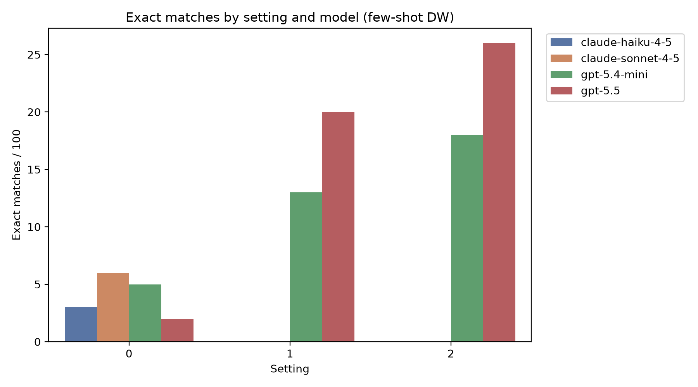
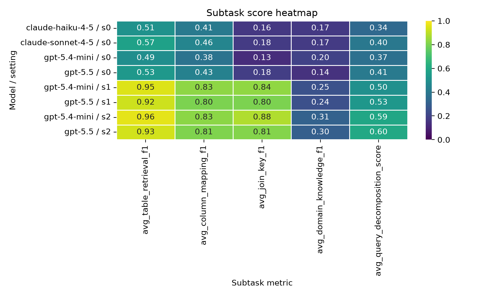
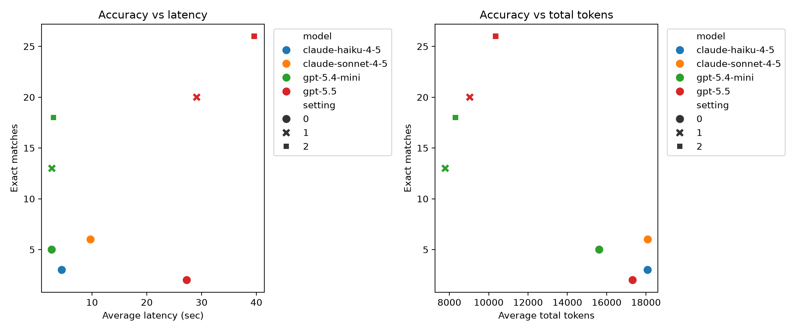

# BEAVER few-shot comparative analysis

## Scope and reading guide
- Source CSV: [beaver_results_across_settings_models_20260722.csv](beaver_results_across_settings_models_20260722.csv)
- Scope: few-shot BEAVER DW runs only, all on the same 100-query evaluation slice.
- Main outcome metric: exact match count.
- Supporting metrics: subtask scores for table retrieval, column mapping, join key alignment, domain knowledge, and query decomposition.
- Resource metrics: average latency, total tokens, and cost proxies.

## Short answer
- Larger models do appear to outperform smaller models on final correctness, but the gap is not purely a parameter-count story.
- The most dramatic lift comes from changing the setting from 0 to 1, especially for smaller models.
- A small model can get much closer to the large model with richer settings, but still does not fully close the gap.
- The remaining bottleneck is not schema lookup alone; it is structural reasoning and decomposition fidelity.

## Evidence snapshot
| model | setting | exact_matches | avg_table_retrieval_f1 | avg_column_mapping_f1 | avg_join_key_f1 | avg_domain_knowledge_f1 | avg_query_decomposition_score | avg_latency_sec | avg_total_tokens |
|---|---:|---:|---:|---:|---:|---:|---:|---:|---:|
| claude-haiku-4-5 | 0 | 3 | 0.511164 | 0.407426 | 0.163939 | 0.165206 | 0.338462 | 4.473995 | 18085.33 |
| claude-sonnet-4-5 | 0 | 6 | 0.570137 | 0.455433 | 0.175032 | 0.172000 | 0.400000 | 9.728563 | 18092.46 |
| gpt-5.4-mini | 0 | 5 | 0.492057 | 0.379278 | 0.126675 | 0.199143 | 0.367033 | 2.640478 | 15621.70 |
| gpt-5.5 | 0 | 2 | 0.534740 | 0.433749 | 0.183366 | 0.142524 | 0.406593 | 27.290419 | 17320.56 |
| gpt-5.4-mini | 1 | 13 | 0.949129 | 0.828867 | 0.835018 | 0.250706 | 0.496703 | 2.671689 | 7788.95 |
| gpt-5.5 | 1 | 20 | 0.923971 | 0.802006 | 0.802310 | 0.243262 | 0.527473 | 29.100938 | 9039.28 |
| gpt-5.4-mini | 2 | 18 | 0.958895 | 0.825610 | 0.881825 | 0.309381 | 0.591209 | 2.960252 | 8307.25 |
| gpt-5.5 | 2 | 26 | 0.930284 | 0.806508 | 0.814500 | 0.300383 | 0.597802 | 39.612322 | 10349.74 |

## What the numbers say
### 1. Larger models win in aggregate
The clearest pattern is that the large model is strongest in the final outcome on the same task setting. At setting 2, `gpt-5.5` reaches 26 exact matches, while `gpt-5.4-mini` reaches 18.

### 2. The setting ladder matters a lot for small models
For `gpt-5.4-mini`, moving from setting 0 to 1 improves exact matches from 5 to 13. Moving to setting 2 pushes it to 18. That is a very large gain from prompt structure alone.

### 3. Structure-heavy subtasks improve first
Table retrieval, column mapping, and join key alignment jump sharply under settings 1 and 2. That suggests that the biggest early gains are from schema grounding and relational composition, not from raw semantic reasoning alone.

### 4. Domain knowledge and decomposition remain the hardest parts
Even at the best setting, the domain-knowledge and decomposition scores stay fairly modest. This is the evidence that the remaining gap is not just “finding the tables,” but also getting the question decomposition and compositional logic right.

### 5. Resource tradeoff is substantial
The large model is much slower on average in the same setting ladder. For example, `gpt-5.5` is around 39.6 seconds latency at setting 2 versus about 3.0 seconds for `gpt-5.4-mini`. So if a smaller model can get within a few queries of the large model, that is a compelling practical tradeoff.

## Visual walkthrough
### Accuracy by setting

This chart shows the biggest headline: the setting ladder helps the small model far more than it helps the large model, and the large model still leads overall.

### Subtask heatmap

This is the diagnostic view. The strongest gains are in the structural subtasks: retrieval, mapping, and joins. The decomposition score stays comparatively low, reinforcing that the final reasoning step is still the bottleneck.

### Resource tradeoff

This shows the cost/latency tradeoff directly. The small model is much cheaper and much faster in the same setting regime, while the large model buys additional correctness with substantially more latency.

## Interpretation
If your question is “do larger models perform better?”, the evidence here says yes, but the reason is not just model size. The setting changes appear to be a powerful lever for smaller models. In practice, the strong small-model result at setting 2 suggests that structured prompting can recover a non-trivial share of the large-model advantage without paying the full latency cost.

The remaining question is whether the improvement is stable across examples. That is why the per-run JSON logs in [eval/unified-output/fewshot](eval/unified-output/fewshot) are the right next place to look.