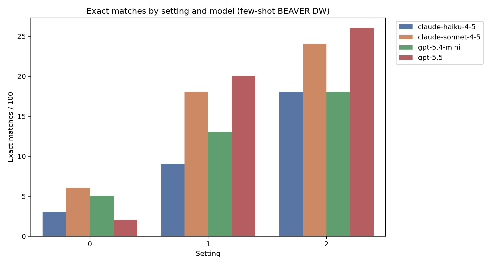
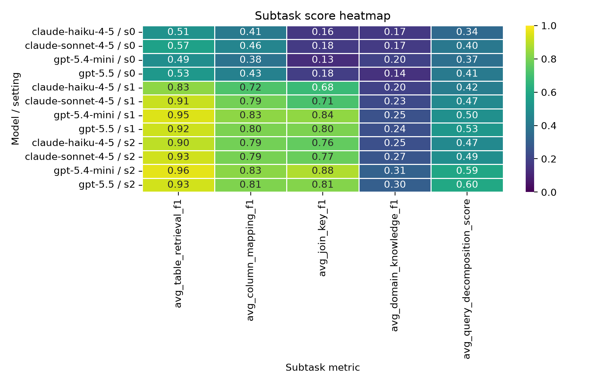
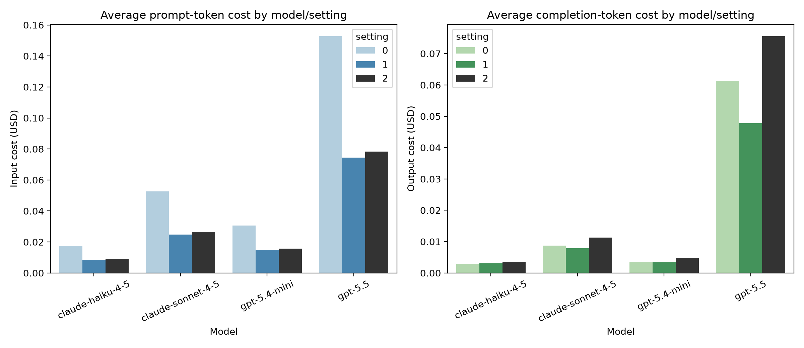
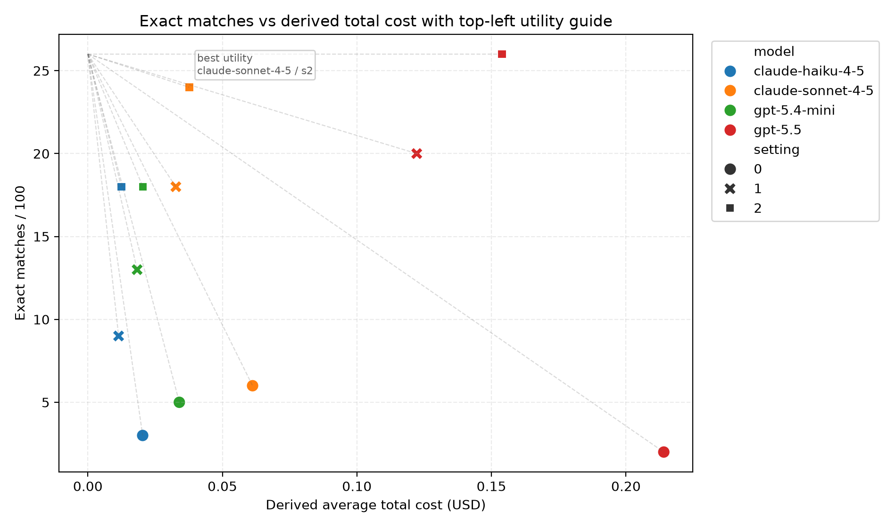

# BEAVER few-shot comparative analysis (20260801)

## Scope
- Source CSV: [beaver_results_across_settings_models_20260801.csv](beaver_results_across_settings_models_20260801.csv)
- Pricing source: [model_pricing.csv](model_pricing.csv)
- Dataset: few-shot BEAVER DW runs only.
- Models included: Claude Haiku 4.5, Claude Sonnet 4.5, GPT-5.4-mini, and GPT-5.5.
- All runs use the same 100-question evaluation slice.

## Main findings
- The large OpenAI model remains the strongest in absolute correctness at the top end of the ladder.
- Claude Sonnet 4.5 is the best Claude model in the current sweep and is notably stronger than Claude Haiku 4.5.
- The cost signal is dominated by the prompt-input side at low settings and by completion output side for some larger runs.
- A simple utility view, defined as exact-match rate divided by average total cost, changes the ranking: the best cost-adjusted systems are the lower-cost setting-2 runs, especially Claude Haiku 4.5 and GPT-5.4-mini.
- In the updated scatter, the dashed lines point back toward the top-left ideal corner (highest accuracy, lowest cost), and the normalized distance-to-ideal is a compact visual proxy for cost-adjusted utility.

## Utility ranking
The utility metric used here is `exact_match_rate / avg_total_cost_usd`, so larger values mean more correctness per dollar. The current top-ranked points are:

| model             |   setting |   exact_matches |   avg_total_cost_usd |   exact_match_rate |   utility_accuracy_per_cost |   utility_matches_per_cost |   distance_to_top_left |
|:------------------|----------:|----------------:|---------------------:|-------------------:|----------------------------:|---------------------------:|-----------------------:|
| claude-haiku-4-5  |         2 |              18 |             0.01245  |               0.18 |                   14.4583   |                 1445.83    |               0.333371 |
| gpt-5.4-mini      |         2 |              18 |             0.020429 |               0.18 |                    8.81122  |                  881.122   |               0.33628  |
| claude-haiku-4-5  |         1 |               9 |             0.011427 |               0.09 |                    7.87578  |                  787.578   |               0.708333 |
| gpt-5.4-mini      |         1 |              13 |             0.018312 |               0.13 |                    7.09905  |                  709.905   |               0.542731 |
| claude-sonnet-4-5 |         2 |              24 |             0.03768  |               0.24 |                    6.36938  |                  636.938   |               0.154043 |
| claude-sonnet-4-5 |         1 |              18 |             0.032703 |               0.18 |                    5.50401  |                  550.401   |               0.349478 |
| gpt-5.5           |         2 |              26 |             0.153882 |               0.26 |                    1.6896   |                  168.96    |               0.703003 |
| gpt-5.5           |         1 |              20 |             0.122235 |               0.2  |                    1.63619  |                  163.619   |               0.601267 |
| claude-haiku-4-5  |         0 |               3 |             0.020372 |               0.03 |                    1.47261  |                  147.261   |               0.959349 |
| gpt-5.4-mini      |         0 |               5 |             0.033996 |               0.05 |                    1.47075  |                  147.075   |               0.88206  |
| claude-sonnet-4-5 |         0 |               6 |             0.061223 |               0.06 |                    0.980022 |                   98.0022  |               0.86881  |
| gpt-5.5           |         0 |               2 |             0.214065 |               0.02 |                    0.09343  |                    9.34296 |               1.41421  |

## Evidence snapshot
| model             |   setting |   exact_matches |   avg_table_retrieval_f1 |   avg_column_mapping_f1 |   avg_join_key_f1 |   avg_domain_knowledge_f1 |   avg_query_decomposition_score |   avg_latency_sec |   avg_total_tokens |   avg_input_cost_usd |   avg_output_cost_usd |   avg_total_cost_usd |
|:------------------|----------:|----------------:|-------------------------:|------------------------:|------------------:|--------------------------:|--------------------------------:|------------------:|-------------------:|---------------------:|----------------------:|---------------------:|
| claude-haiku-4-5  |         0 |               3 |                 0.511164 |                0.407426 |          0.163939 |                  0.165206 |                        0.338462 |           4.474   |           18085.3  |             0.017514 |              0.002858 |             0.020372 |
| claude-sonnet-4-5 |         0 |               6 |                 0.570137 |                0.455433 |          0.175032 |                  0.172    |                        0.4      |           9.72856 |           18092.5  |             0.052541 |              0.008682 |             0.061223 |
| gpt-5.4-mini      |         0 |               5 |                 0.492057 |                0.379278 |          0.126675 |                  0.199143 |                        0.367033 |           2.64048 |           15621.7  |             0.030555 |              0.003441 |             0.033996 |
| gpt-5.5           |         0 |               2 |                 0.53474  |                0.433749 |          0.183366 |                  0.142524 |                        0.406593 |          27.2904  |           17320.6  |             0.152776 |              0.061289 |             0.214065 |
| claude-haiku-4-5  |         1 |               9 |                 0.831511 |                0.721535 |          0.679234 |                  0.196048 |                        0.41978  |           5.25158 |            8996.56 |             0.008389 |              0.003039 |             0.011427 |
| claude-sonnet-4-5 |         1 |              18 |                 0.914693 |                0.785196 |          0.713314 |                  0.225349 |                        0.47033  |           9.48465 |            8802.9  |             0.024835 |              0.007868 |             0.032703 |
| gpt-5.4-mini      |         1 |              13 |                 0.949129 |                0.828867 |          0.835018 |                  0.250706 |                        0.496703 |           2.67169 |            7788.95 |             0.014894 |              0.003418 |             0.018312 |
| gpt-5.5           |         1 |              20 |                 0.923971 |                0.802006 |          0.80231  |                  0.243262 |                        0.527473 |          29.1009  |            9039.28 |             0.074472 |              0.047764 |             0.122235 |
| claude-haiku-4-5  |         2 |              18 |                 0.90232  |                0.785404 |          0.758952 |                  0.246    |                        0.47033  |           4.3378  |            9623.08 |             0.008916 |              0.003533 |             0.01245  |
| claude-sonnet-4-5 |         2 |              24 |                 0.925887 |                0.793668 |          0.77204  |                  0.269516 |                        0.49011  |          11.2181  |            9555.13 |             0.026412 |              0.011269 |             0.03768  |
| gpt-5.4-mini      |         2 |              18 |                 0.958895 |                0.82561  |          0.881825 |                  0.309381 |                        0.591209 |           2.96025 |            8307.25 |             0.015661 |              0.004768 |             0.020429 |
| gpt-5.5           |         2 |              26 |                 0.930284 |                0.806508 |          0.8145   |                  0.300383 |                        0.597802 |          39.6123  |           10349.7  |             0.078305 |              0.075577 |             0.153882 |

## Cost derivation
Average total cost was derived from the pricing sheet by:
- prompt cost = avg_prompt_tokens / 1,000,000 × cost per million input tokens
- completion cost = avg_completion_tokens / 1,000,000 × cost per million output tokens
- total cost = prompt cost + completion cost

This means the reported average cost does not depend on the blank `avg_cost_usd` column in the experiment CSV; it is derived explicitly from the pricing lookup.

## Figures
### Accuracy by setting

### Subtask heatmap

### Cost components

### Cost vs accuracy

