# Reasoning-trace analysis — figures and findings

Companion to `report.md` (the prose-first version). This version walks through
the 14 figures in order, each with its image and explanation inline. Same
underlying numbers throughout — see `report.md` for the more compact narrative
and `outputs/tables/` for the raw data behind every figure.

**Scope**: dataset `dw`, setting 2, 6 models (`claude-haiku-4-5`, `claude-sonnet-5`,
`claude-opus-5`, `gpt-5.6-luna`, `gpt-5.6-terra`, `gpt-5.6-sol`) + 5 human reference
rationales. 600 attempted instances, 515 with a captured reasoning trace, 47 with a
trace from all 6 models. No LLM prompting or LLM-based labeling anywhere — all
features are lexical, embedding-based, or a small trained classifier.

**Read this before anything else**: brand and trace *format* are almost totally
confounded in this dataset — 100% of OpenAI traces are a bold-header summary
(the signature of the Responses API's `reasoning.summary`) vs. 0–9% of Anthropic's,
which are the model's actual raw extended-thinking text. Every "brand" finding
below is at least partly a "raw vs. summarized" finding, and the two can't be
statistically separated here (see Figure 5's caveat and the Limitations section).

---

## Figure 1 — How much data per model, and how accurate is each?

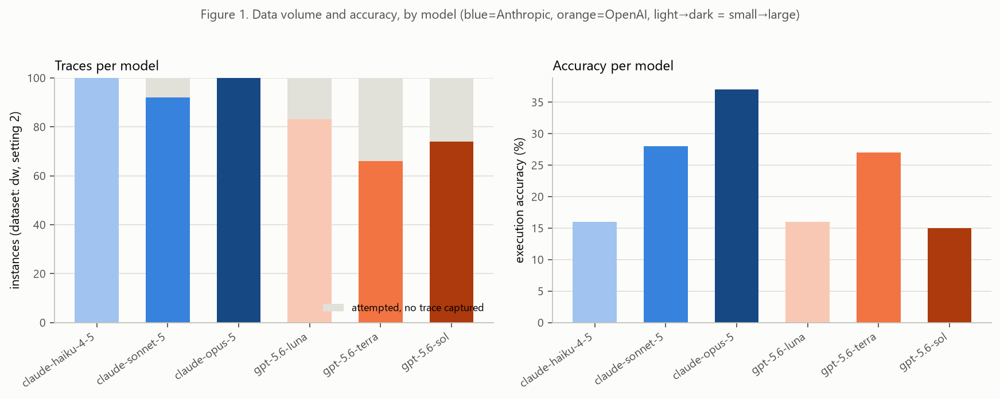

Accuracy ranges from 15% (`gpt-5.6-sol`) to 37% (`claude-opus-5`). Trace coverage
(the gray segment = attempted but no reasoning trace captured) is 100% for
`claude-haiku-4-5`/`claude-opus-5`, down to 66% for `gpt-5.6-terra`. That
missingness is *not* random with respect to correctness for `gpt-5.6-luna` and
`gpt-5.6-terra` specifically — the API returns a captured trace for only 56% of
their correct answers vs. 88%/70% of their incorrect ones, even though
`reasoning_tokens` confirms real internal reasoning happened either way.
Correctness-conditioned results for those two models should be read as
lower-confidence than the rest.

---

## Figure 2 — How long are traces, and how does that relate to format?

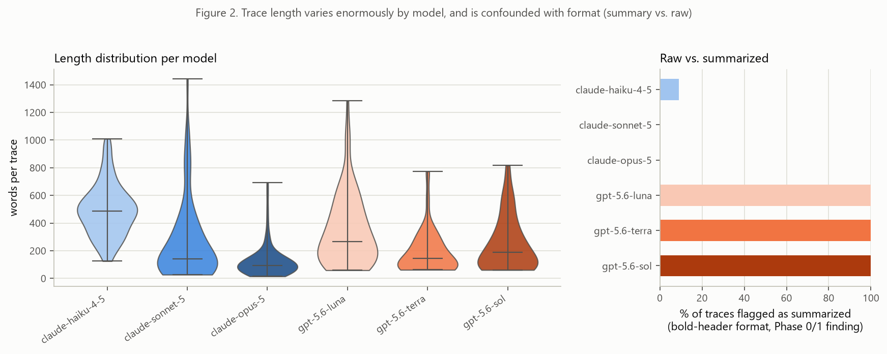

Trace length varies by an order of magnitude: `claude-opus-5` traces have a
median of ~93 words, `claude-haiku-4-5` a median of ~488 (words counted after
stripping markdown headers/code blocks). The right panel shows
exactly the brand/format confound described above — essentially every OpenAI
trace is a summary, essentially no Anthropic trace is (haiku is the one partial
exception, at ~9%). Length and format are themselves entangled: the two shortest,
most terse models (`opus`, `sonnet`) are also the two with almost no visible
"process" language, which matters for how to read Figures 8–9.

---

## Figure 3 — Do models cluster by brand or by size?

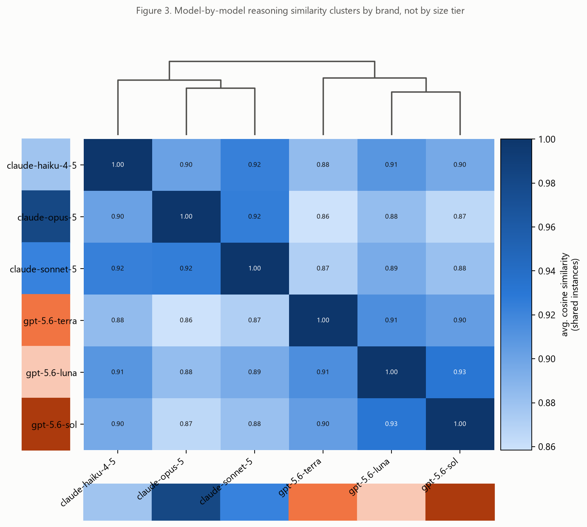

Hierarchical clustering on shared-instance trace-embedding similarity splits
cleanly into two branches — and they're exactly the Anthropic/OpenAI split,
before the dendrogram ever sees a brand label. Within a brand, pairwise similarity
is 0.90–0.93; across brands it is 0.86–0.91 — the ranges touch (`haiku`–`luna` is
0.909), so the split is a clear tendency, not a hard gap. Clustering follows
brand, not size tier — e.g. `claude-opus-5` (large) is more similar to
`claude-haiku-4-5` (small, same brand; 0.90) than to any OpenAI model (0.86–0.88).

---

## Figure 4 — Same question, in 2D, with instance content removed

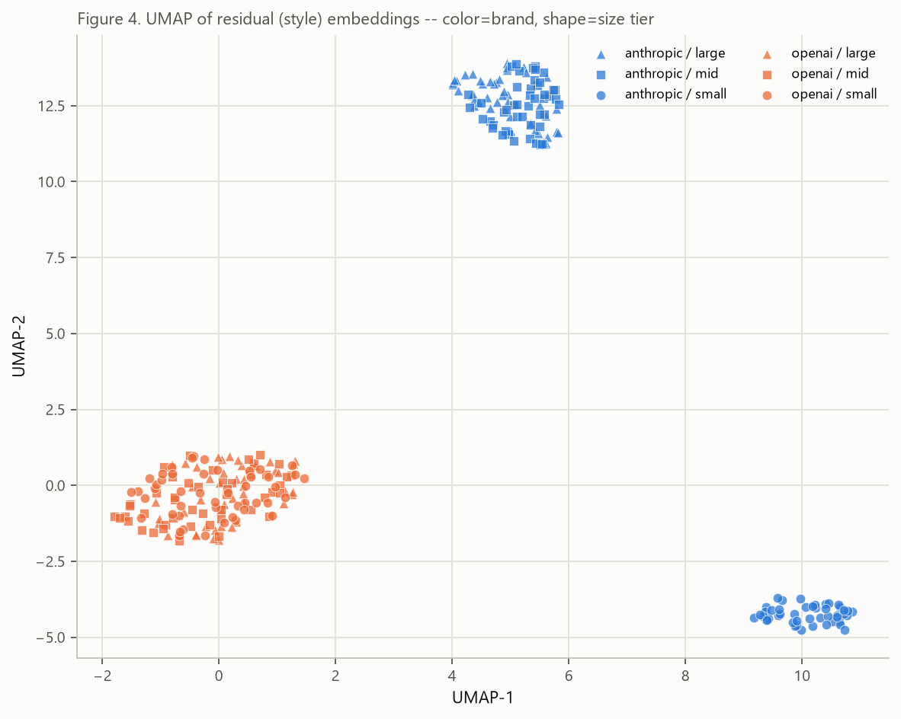

This is on *residual* embeddings — for each instance, the mean embedding across
all 6 models is subtracted out, isolating style from content. Brand (color) still
separates cleanly even after removing what's specific to each question. There are
three clusters, not two: `claude-haiku-4-5` (all circles, bottom right) sits by
itself, `claude-opus-5` + `claude-sonnet-5` (triangles/squares, top) form a second
cluster, and all three OpenAI models are one intermixed blob — the plot cannot tell
`luna`, `terra`, and `sol` apart. (Don't read cluster *size* or the distance
between clusters as meaningful; and note that overlap in 2D hides real
differences: opus vs. sonnet look mixed here but are ~91% separable in the full
1024-dimensional space. See `figure_guide.md`.)

---

## Figure 5 — How separable is brand vs. size, from embeddings vs. lexical features?

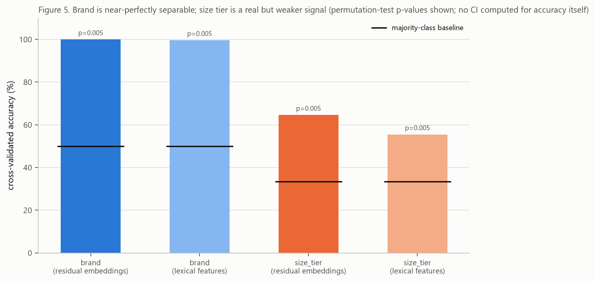

A logistic-regression probe (GroupKFold by instance, permutation-tested) predicts
**brand at 100% (embeddings) / 99.6% (lexical features)** accuracy against a 50%
majority baseline — both p=0.005. The single strongest lexical driver of that
result is `is_summary` itself, confirming this is substantially the format
confound, not a subtle stylistic signature. **Size tier is separable too, but far
more weakly**: 65% (embeddings) / 55% (lexical) vs. a 33% baseline, still
p=0.005 — a real signal, just nowhere near as strong as brand. No CI is shown on
the bars themselves (only the permutation p-value was computed for accuracy; no
bootstrap CI on accuracy was run).

---

## Figure 6 — Per-feature style profile per model, with uncertainty

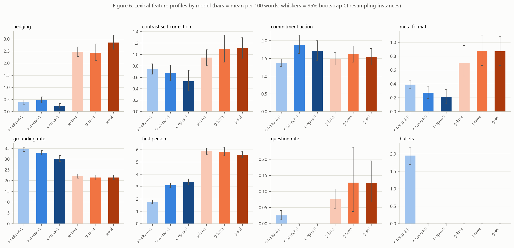

Eight lexical rate features (per 100 words), one per panel, with 95%
bootstrap CIs (resampling instances within each model). `grounding_rate` — the
share of tokens matching actual schema/prompt vocabulary — is visibly higher for
Anthropic models, consistent with raw thinking walking through the real schema
rather than narrating about it. `first_person` and `hedging` trend higher for
OpenAI's narrated summaries.

---

## Figure 7 — Which specific words distinguish brand / size?

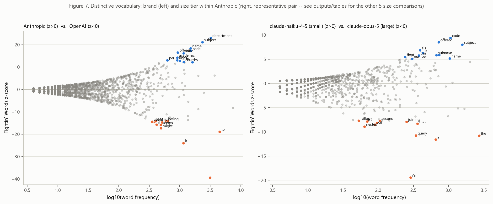

Log-odds with an informative Dirichlet prior (Monroe et al.). Left: brand — words
like `department`, `subject`, `name`, `code`, `offered` skew Anthropic
(schema-grounded vocabulary), while `might`, `seems`, `if`, `i` skew OpenAI
(hedging + first-person narration). Right: a representative size comparison
(`claude-haiku-4-5` vs. `claude-opus-5`, within-brand small vs. large) — the
other 5 possible size comparisons (openai small/mid/large, anthropic mid) are in
`outputs/tables/fightin_words_size_*.csv` but not separately plotted here.

---

## Figure 8 — What mix of reasoning moves does each model (and human) use?

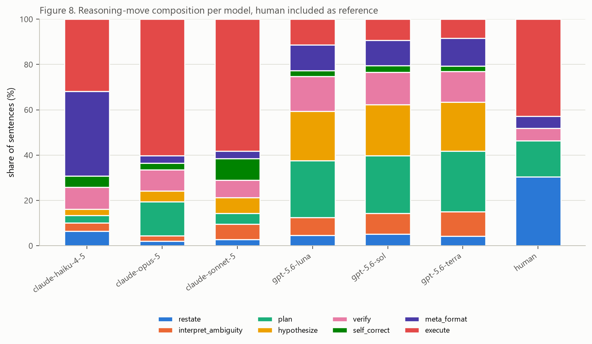

Eight bootstrapped move categories (restate / interpret_ambiguity / plan /
hypothesize / verify / self_correct / meta_format / execute), human included as
the rightmost reference bar. `claude-opus-5` and `claude-sonnet-5` are
extremely `execute`-dominated (58–60%) with little else — almost certainly a
**length artifact** (they're also the two shortest-trace models from Figure 2; a
5-sentence trace mostly *is* "writing the query"), not necessarily a distinct
reasoning style. `claude-haiku-4-5` (much longer traces) shows a far more
diverse mix. The `gpt-5.6-*` models spread evenly across
plan/hypothesize/verify/meta_format/execute.

**The single most striking number in this whole analysis is here**: **humans
restate the question in ~30% of their sentences (0.304); no model exceeds 6.5%.**
Every model, regardless of brand or format, frames the problem far less than a
human does when explaining their own reasoning.

---

## Figure 9 — What follows what, and how far apart are models' move usage?

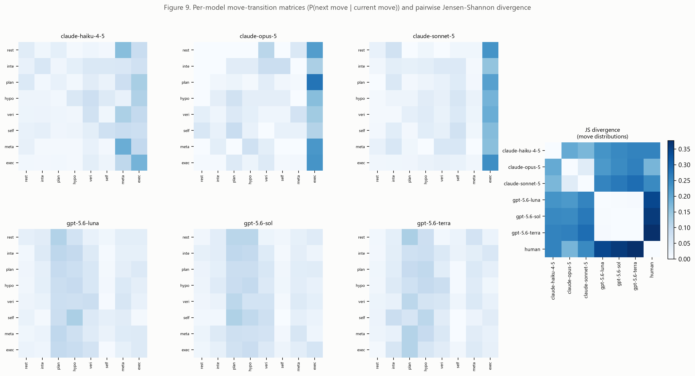

Left 6 panels: per-model P(next move | current move). The terse Anthropic models
show heavy "→execute" columns; the OpenAI models show more spread-out transitions
centered on "→plan". Right: pairwise Jensen-Shannon divergence between every
model's (and human's) move distribution. The three `gpt-5.6-*` models are nearly
identical to each other (JS 0.001–0.004); Anthropic-vs-OpenAI pairs sit around
0.22–0.29; and **`human` is the single most distinct row in the entire matrix**
(JS 0.18–0.38 against every model) — human explanations are compositionally
unlike any of the 6 models, not just unlike one brand.

*Data-quality note*: the underlying move classifier initially had a real bug — an
unweighted classifier collapsed `restate` and `self_correct` (the two rarest
seed categories, <2% each) to zero predictions across the entire corpus. Fixed
with `class_weight="balanced"`; hand-labeled validation afterward gave
**Cohen's κ=0.94 (95% raw agreement, n=200)**, though `restate` still didn't
appear in that 200-sentence sample and `self_correct` had only 1 example — those
two categories remain less validated than the other 6.

---

## Figure 10 — Does reasoning drift from the prompt, and how fast?

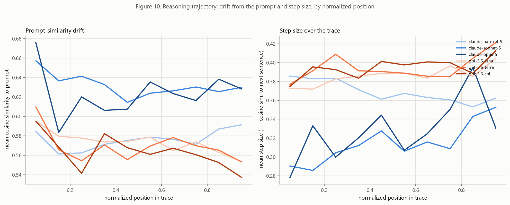

Left: cosine similarity between each sentence and the original prompt, over
normalized position in the trace (0=first sentence, 1=last). Right: step size
(1 − cosine similarity to the next sentence) over the same normalized position.
This does **not** split by brand. The two terse Anthropic models (`opus`,
`sonnet`) have the highest prompt similarity (~0.60–0.68) and the smallest step
sizes early on (~0.28–0.30, rising toward the end); `haiku` and all three OpenAI
models sit lower on prompt similarity (~0.54–0.61) and take larger, steadier steps
(~0.35–0.42). Treat this figure as weak evidence: the lines are noisy with no
CIs drawn, `opus` traces have only ~4 sentences (so each bin is 1–2 sentences),
and "similarity to the prompt" is measured against only the first 512 tokens of a
~13,000-token prompt (the embedding model's input limit) — mostly the generic
instruction boilerplate, not the question or schema.

---

## Figure 11 — Does revisiting earlier reasoning associate with correctness?

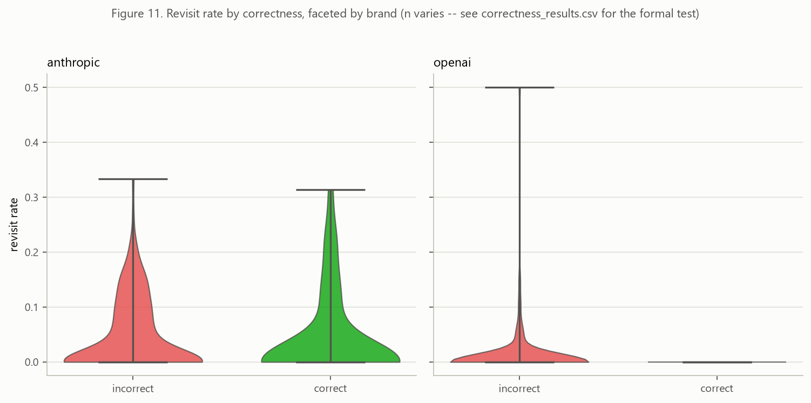

Revisit rate = share of sentences whose closest match is a *non-adjacent* earlier
sentence (similarity > 0.884, the 90th percentile of that within-trace
distribution — tuned, not a fixed constant). Split by correct/incorrect within
each brand. **There is no visible correct/incorrect separation for Anthropic**
(mean 0.048 incorrect vs. 0.041 correct). For OpenAI, all 36 correct traces have a
revisit rate of exactly 0 vs. only 20 non-zero cases among 187 incorrect ones —
too few non-zero values to conclude anything. Traces under 3 sentences (31
`opus`, 16 `sonnet`) have no defined revisit rate and are excluded here. The
formal test on revisit rate is in the correctness battery behind Figure 12 (it
does not survive multiple-testing correction, p_BH=0.87).

---

## Figure 12 — Which style features actually predict correctness?

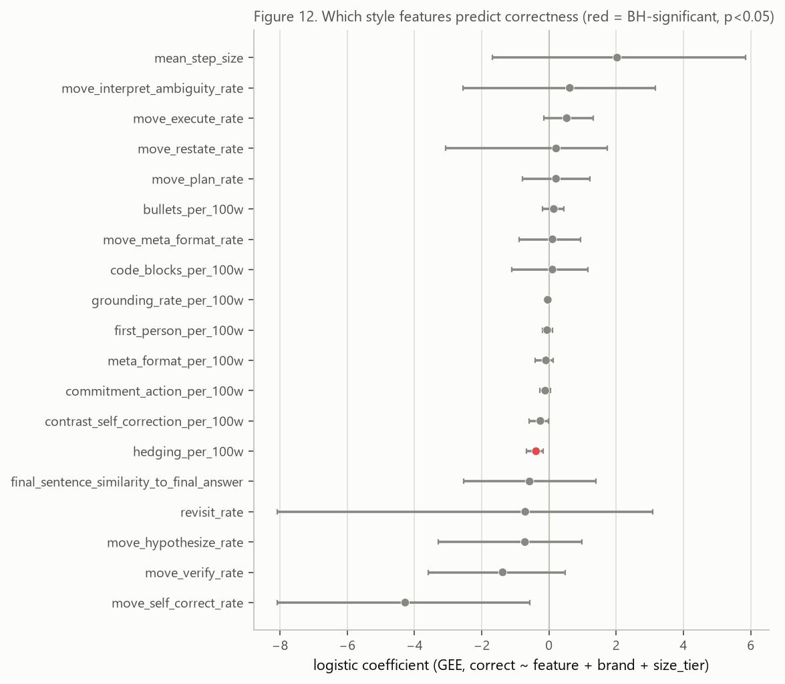

20 style features tested via `correct ~ feature + brand + size_tier` (GEE,
grouped by instance), 95% CI from 200 bootstrap resamples of *instances*, and
Benjamini-Hochberg correction across the family. **Only `hedging_per_100w`
survives correction** (red dot): coefficient −0.39, 95% CI [−0.67, −0.17],
p_BH=0.031, n=515 — more hedging predicts *lower* correctness. This only
reached significance at full data scale (it didn't clear correction on a
50-per-model dev sample). `move_self_correct_rate` has a CI excluding zero
(−8.09 to −0.58) but doesn't survive correction (p_BH≈0.35) — combined with its
thin validation in Figure 9's note, treat it as suggestive only.

*Not shown as a figure*: the brand/size_tier mixed-effects results
(`mixed_effects_results.csv`) have p-values as small as 1e-127. These are
**not a valid population-level significance claim** — brand only truly varies at
the model level (3 vs. 3 models), and the model's only random effect is on
`instance_id`, which doesn't correct for that. Trust the direction/magnitude of
those effects (consistent with everything else in this report), not the p-value.

---

## Figure 13 — Which reasoning steps match the human's, and which don't?

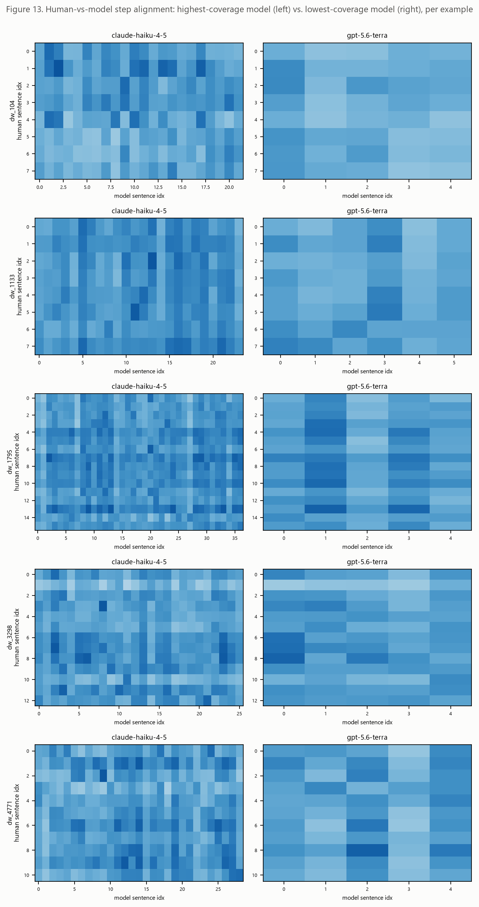

One row per human example, comparing the highest-coverage model
(`claude-haiku-4-5`, left) against the lowest-coverage model (`gpt-5.6-terra`,
right) — sentence-by-sentence cosine similarity, human sentences on the y-axis,
model sentences on the x-axis. Darker cells = closer semantic match. `terra`'s
panels are visibly more uniform/lighter — fewer of its sentences closely match
any specific human sentence, consistent with its low coverage score below.

*Methodological note*: the match threshold here (0.703) is **not** the same as
Figure 11's revisit threshold (0.884) — reusing the within-trace threshold was
tried first and produced 0% coverage everywhere, because cross-author paraphrase
similarity (human vs. model, different vocabulary for the same idea) sits
structurally lower than within-trace near-duplicate similarity. 0.703 was tuned
separately (90th percentile of the pooled human-vs-model similarity
distribution) and, like the revisit threshold, should be read as a calibrated
choice from a small sample, not a validated ground truth.

---

## Figure 14 — Which models cover the human's points vs. add unrelated content?

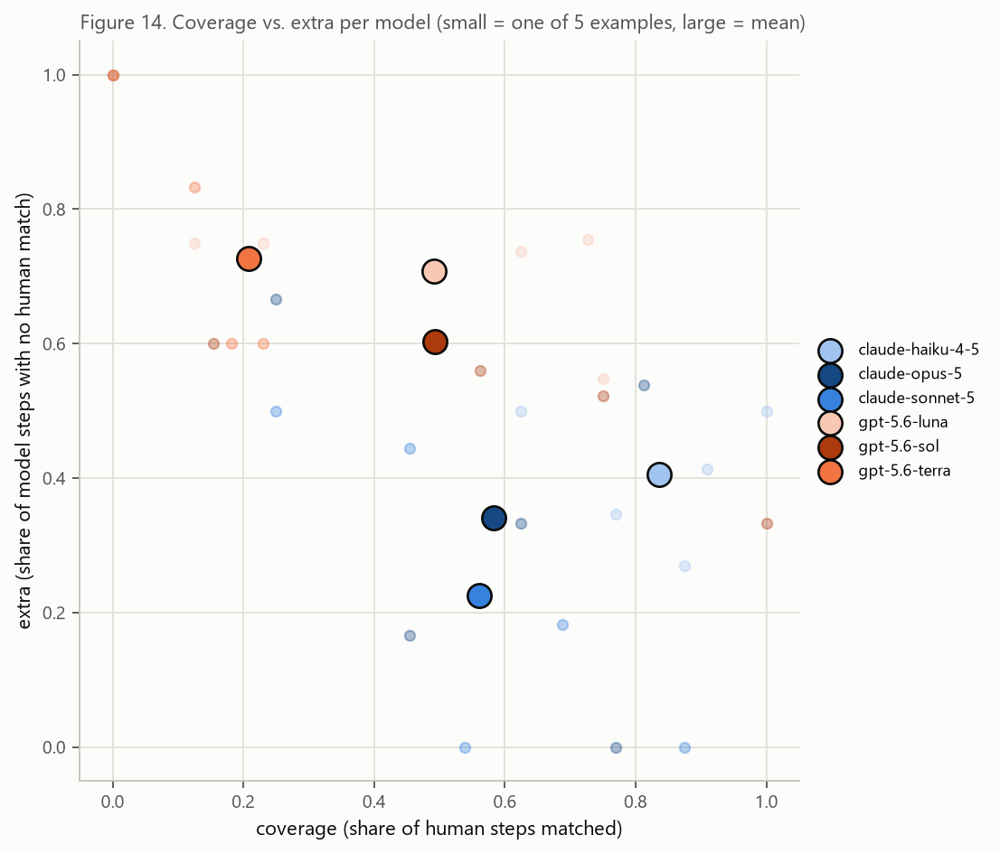

Small dots = one of the 5 examples; large outlined dots = per-model mean.
**`claude-haiku-4-5` has the highest average coverage (84%)** — the share of
human sentences it has *some* matching content for — though this is likely
partly a length effect (it also has by far the longest traces, so simply more
material to potentially match against). **`gpt-5.6-terra` is the least
human-aligned model**: lowest coverage (21%) and highest "extra" (73% of its own
sentences match nothing the human said). Separately, `claude-haiku-4-5` also
ranks #1 by raw trace-embedding similarity to the human explanation on **all 5
of 5 examples** (0.92–0.94 similarity vs. 0.77–0.91 for every other model) — an
independent method reaching the same conclusion as the clustering in Figures 3–4,
this time against real external human text rather than internal model-to-model
comparison.

Human rationales here are after-the-fact explanations of the gold query (used as
the "final answer" analog for the human's own metrics, since a human trace has
no `predicted_0.sql` of its own) — not a think-aloud toward an answer still being
constructed. Keep that in mind when comparing "human reasoning style" to a model
mid-generation. All human-comparison numbers are descriptive only (n=5, no
significance tests, per the original analysis spec).

---

## Limitations, in one place

1. **Brand ≈ format**, not cleanly separable in this dataset. Every "brand" claim
   should be read with that in mind.
2. **Size tier is a price-based proxy** (ranked within brand from
   `model_pricing.csv`), not a real parameter count.
3. **Brand/size mixed-effects p-values are anti-conservative** (n=3 models per
   brand) — use effect direction/magnitude, not the raw p-value.
4. **Move-taxonomy validation is uneven** — solid for 6 of 8 moves (κ=0.94), thin
   for `restate` and `self_correct`.
5. **Length is a running confound** across move composition, revisit rate, and
   human-alignment coverage — only partially controlled for (via
   `log(completion_tokens)` in the mixed-effects models).
6. **n=5 for the human comparison** — descriptive only, no significance tests.
7. **`reasoning_tokens` is OpenAI-only** — Anthropic's API reports no separate
   reasoning-token count, so it wasn't usable as a cross-brand covariate.
8. **The 47 problems traced by all six models are a harder-than-average slice**
   (mean accuracy 16.3% on them vs. 29.2% on the other 53; more nested/multi-CTE
   problems). Figures 3–5 and the human comparison (13–14) use only this subset.
9. **Apostrophe normalization bug**: OpenAI's text uses curly apostrophes
   (`I’ll`), Anthropic's straight ones, and the normalizer doesn't unify them.
   Measured effect: Fig 7's OpenAI `i` z-score is −39.4 as published vs. −32.7 after
   unifying; OpenAI's `commitment_action` in Fig 6 is understated (~1.5 → ~1.85).
   No headline conclusion changes. Not yet fixed.

For the math, sample sizes, assumptions, axes and justification behind every
figure (including a full UMAP explanation and a decoding of the lexical features
and reasoning moves), see `figure_guide.md`.

All figures are also in `outputs/figures/` as standalone `.png`/`.svg`; all
underlying numbers are in `outputs/tables/`.
