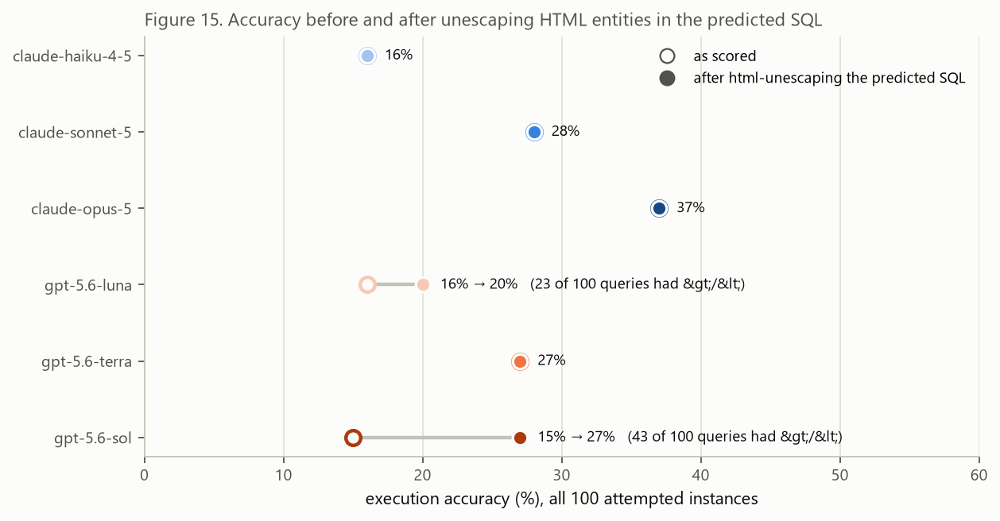
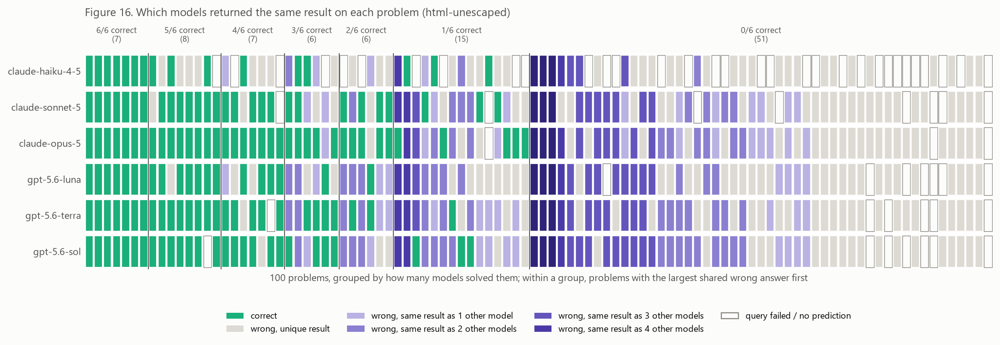
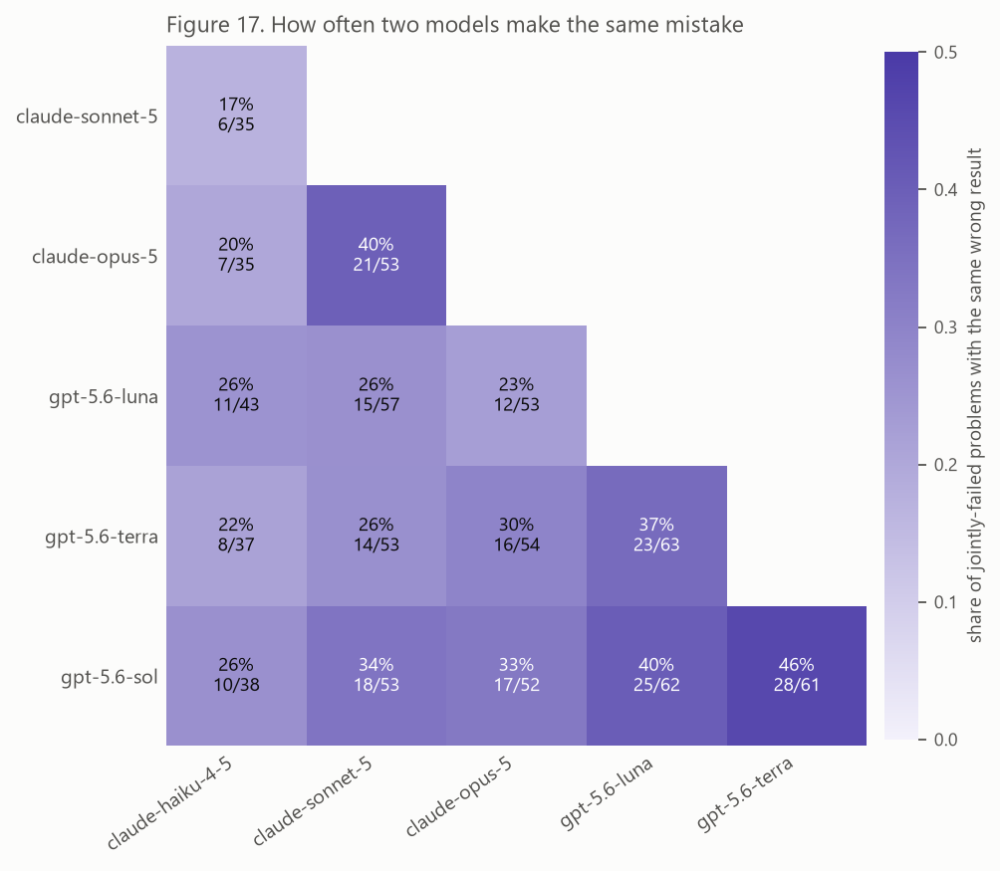
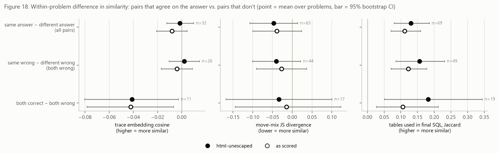
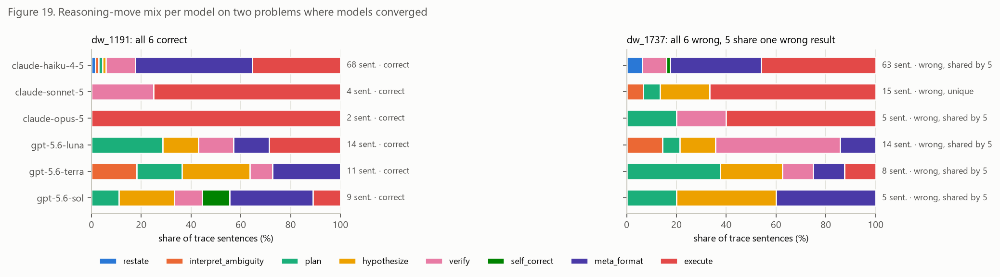

# Answer convergence: same answers, same mistakes, same reasoning?

*2026-10-09. Companion to `report.md` / `report_with_figures.md` (Figures 1–14); this
report adds Figures 15–19. Code: `src/convergence.py`, `src/figures_convergence.py`;
stage `--stage convergence`. Tables: `outputs/tables/convergence_*`.*

## Questions

1. When models reach the **same final answer**, did they get there with similar reasoning?
2. When models **fail**, do they fail the same way (return the same wrong result), or does
   each fail differently?

## Short answer

- **Models agree on wrong answers more often than chance would suggest.** On the 51 problems
  no model solved, 31 had at least two models return the identical wrong result (24 had three or
  more), and 46% of executed wrong queries returned exactly the same result as at least one other
  model.
  Same-brand pairs share mistakes most: sol–terra 46%, opus–sonnet 40%, luna–sol 40%,
  against 22–34% for cross-brand pairs (Figure 17).
- **Agreeing on the answer does not show up as more similar reasoning.** Within a problem,
  pairs that return the same result have trace embeddings no more similar than pairs that
  don't (Δcos = −0.001, 95% CI [−0.012, 0.010]). The reasoning-move mix is at most slightly
  more similar (ΔJS = −0.047, CI [−0.107, 0.014]). The final SQL does converge: same-answer
  pairs use more of the same tables (ΔJaccard = +0.13, CI [0.08, 0.19]) (Figure 18).
  At the level these measures can see, the models write differently and still arrive at
  the same query.
- **Some unanimous wrong answers look like gold or question problems**, not shared model
  mistakes (3 problems, see [Unanimous wrong answers](#unanimous-wrong-answers-gold-check)).
- **Scoring issue found along the way:** `gpt-5.6-sol` and `gpt-5.6-luna` write `&gt;`/`&lt;`
  inside their `<ans>` tags. MySQL rejects these, so the queries score as wrong. Unescaping them
  moves sol from **15% → 27%** and luna from **16% → 20%** (Figure 15). Everything below
  uses the unescaped results unless it says otherwise. The as-scored version is kept alongside it, and
  the conclusions don't change.

## Method

**Data.** Dataset `dw`, setting 2, 6 models × 100 problems = 600 attempted predictions.
Answer-level results use all 600. Trace-level similarity needs a trace from both models.
Trace-embedding similarity is limited to the 47 problems with a trace from all six (the
stored Phase 2 vectors). Move-mix similarity uses any pair where both traces exist.

**Re-execution.** The gold and predicted SQL for every attempt are re-run against the BEAVER
MySQL database. Re-executed "as scored", the results reproduce the official
`summary_ex_acc.json` correct/incorrect label on **600/600** predictions. The "unescaped"
variant applies `html.unescape` to each prediction first.

**Same answer.** Two predictions agree when their result sets are equivalent under the
benchmark's own rule (`eval/utils/ex_acc.compare_results`): any column permutation,
same set of rows, column names and duplicate rows ignored. Agreement does not depend on
gold, so two wrong predictions can agree. A query that fails to run (syntax error, timeout,
no prediction) never agrees with anything. Per problem, models are grouped into answer
groups by linking agreeing pairs.

**Pair types.** Each (problem, model pair) is labelled `both_correct`,
`both_wrong_same_answer`, `both_wrong_diff_answer` or `one_correct`.

**Similarity measures**, all compared **within the same problem**, so problem content is held
fixed:

| measure | definition | reads as |
|---|---|---|
| trace cosine | cosine of the two traces' mean-pooled `bge-large-en-v1.5` sentence embeddings (Phase 2) | overall semantic content/style of the trace |
| move-mix JS | Jensen–Shannon divergence (base 2) between the two traces' shares of the 8 reasoning moves (Phase 2F classifier) | *how* the trace reasons; lower = more alike |
| table Jaccard | overlap of the physical tables named after FROM/JOIN in the two final queries (CTE names excluded) | whether the final *plans* match; a check on the answer, not the reasoning |

**Contrast.** For each problem that has both kinds of pair, I take mean(metric | kind A) −
mean(metric | kind B), then average that difference over problems. The 95% CI is a
bootstrap over problems (2,000 resamples). This removes the
"easy problems produce similar traces" effect, since every comparison is within one problem.

## Results

### 1. Unescaping changes the GPT accuracies



| model | as scored | unescaped | queries containing `&gt;`/`&lt;` |
|---|---|---|---|
| claude-haiku-4-5 | 16% | 16% | 0 |
| claude-sonnet-5 | 28% | 28% | 0 |
| claude-opus-5 | 37% | 37% | 0 |
| gpt-5.6-luna | 16% | **20%** | 23 |
| gpt-5.6-terra | 27% | 27% | 0 |
| gpt-5.6-sol | 15% | **27%** | 43 |

The entities are in the model's raw response (`generation.log`), not added by the
pipeline. The models appear to treat the `<ans>…</ans>` wrapper as XML and escape its contents. The
official numbers are left untouched. Whether the harness should unescape the extracted
answer is a methodology decision. As scored, sol looks like the weakest OpenAI model; unescaped,
it ties terra. Any brand/size accuracy comparison in the main report inherits this.

### 2. Which models give the same answer, problem by problem



Each column is a problem and each row a model. Green = correct. A wrong cell is shaded by how many
models returned that same wrong result. Outlined empty cells = the query failed or there was no prediction.
Two caveats: when a problem has two different shared wrong results of the same size,
they share a shade; the CSV `convergence_answer_clusters_unescaped.csv` has the exact groups.
`claude-haiku-4-5` has 20 problems with no prediction at all.

| problems solved by k of 6 models | 0 | 1 | 2 | 3 | 4 | 5 | 6 |
|---|---|---|---|---|---|---|---|
| # problems | 51 | 15 | 6 | 6 | 7 | 8 | 7 |

On the **51 problems no model solved**, 258 of 306 predictions executed. For the 50 problems
with at least one executed prediction, the largest group of models sharing one wrong result was:

| largest shared wrong group | 1 (all different) | 2 | 3 | 4 | 5 | 6 (unanimous) |
|---|---|---|---|---|---|---|
| # problems | 19 | 7 | 10 | 10 | 1 | 3 |

So the failures split: on about 40% of all-wrong problems every model is wrong in its own
way; on the other 60%, at least two models land on the identical wrong result set.

How the failures break down (unescaped):

| model | correct | wrong rows | wrong values | wrong columns | empty | exec error | timeout | no prediction |
|---|---|---|---|---|---|---|---|---|
| claude-haiku-4-5 | 16 | 24 | 20 | 3 | 5 | 11 | 1 | 20 |
| claude-sonnet-5 | 28 | 32 | 22 | 6 | 4 | 4 | 2 | 2 |
| claude-opus-5 | 37 | 39 | 16 | 3 | 2 | 2 | 1 | 0 |
| gpt-5.6-luna | 20 | 43 | 14 | 10 | 6 | 6 | 1 | 0 |
| gpt-5.6-terra | 27 | 37 | 23 | 6 | 1 | 6 | 0 | 0 |
| gpt-5.6-sol | 27 | 38 | 18 | 6 | 4 | 6 | 1 | 0 |

"Wrong rows" (right columns, wrong number of distinct rows) is the most common failure
for every model. These are mostly filter and grouping mistakes, not syntax.

### 3. Which pairs make the same mistakes



Each cell shows, of the problems where **both** models were wrong and both queries ran, the share
where they returned the same wrong result.

- **Within OpenAI: 37–46%.** sol–terra 46% (28/61), luna–sol 40% (25/62), luna–terra 37% (23/63).
- **Within Anthropic: opus–sonnet 40% (21/53)**; haiku pairs only 17–20%.
- **Across brands: 22–34%.** The highest are sonnet–sol 34% and opus–sol 33%.
- Of all pairs that agree on a wrong answer, 48% are same-brand, against 40% of all
  both-wrong pairs.

Same-family models share mistakes more than they share them with the other family. That
fits shared training lineage, but the counts are small (35–63 problems per cell) and the
cells are not independent (one problem contributes to many pairs). Haiku's low rates partly
reflect its 20 missing predictions and 11 execution errors, which can never agree with anything.

### 4. Do same-answer pairs reason more alike?



Within-problem difference (same-answer pairs minus different-answer pairs), unescaped:

| metric | same − different answer (all pairs) | same wrong − different wrong | both correct − both wrong |
|---|---|---|---|
| trace cosine (↑ = more alike) | −0.001 [−0.012, 0.010], n=32 | +0.002 [−0.010, 0.015], n=26 | **−0.041 [−0.080, −0.003]**, n=11 |
| move-mix JS (↓ = more alike) | −0.047 [−0.107, 0.014], n=63 | −0.040 [−0.101, 0.021], n=44 | −0.034 [−0.167, 0.100], n=17 |
| table Jaccard (↑ = more alike) | **+0.130 [0.080, 0.185]**, n=69 | **+0.156 [0.086, 0.231]**, n=49 | **+0.182 [0.051, 0.344]**, n=19 |

*n = problems contributing a within-problem difference. As-scored values are the hollow
points in Figure 18 and are in `convergence_contrasts_as_scored.csv`.*

- **Trace embeddings: no relationship with answer agreement.** The estimate is near zero with a tight
  CI. It stays null when split by brand: same-brand pairs +0.009 [−0.007, 0.025] (n=19),
  cross-brand −0.017 [−0.038, 0.005] (n=16), for same-wrong vs. different-wrong. Trace
  similarity is dominated by brand/format instead: mean cosine is 0.916 for same-brand pairs vs. 0.882 for
  cross-brand pairs, whatever the outcome.
- **Both-correct pairs have *less* similar traces than both-wrong pairs** (−0.041). This
  comes from only 11 problems. One plausible reason is that correct traces are shorter and
  more direct (Figure 19, and `claude-opus-5`'s very short traces), and mean-pooled
  embeddings of short traces vary more. Treat it as a lead, not a finding.
- **Move mix: all three estimates point the same way** (same-answer pairs slightly more
  alike), but every CI includes zero. It's a weak hint at most.
- **Final-query tables converge strongly.** This is close to tautological, since the same result
  usually needs the same tables. It is included as a positive control: the measurement
  can detect convergence where convergence exists, which makes the null on traces
  more meaningful.

### 5. Two problems up close



**dw_1191: all six correct.** Seven problems were solved by every model. dw_1191 is the
only one with a trace from all six; the others lack a trace from at least one OpenAI model,
which, as the main report notes, happens more often when the answer is correct. The six
routes to the same result differ in both length and kind:

| model | sentences | dominant moves |
|---|---|---|
| claude-opus-5 | 2 | 100% execute |
| claude-sonnet-5 | 4 | execute + verify |
| gpt-5.6-sol | 9 | meta_format, hypothesize, plan, small self_correct |
| gpt-5.6-terra | 11 | hypothesize, meta_format, plan, interpret_ambiguity; **no** execute |
| gpt-5.6-luna | 14 | plan, execute, hypothesize, verify |
| claude-haiku-4-5 | 68 | meta_format, execute |

Pairwise move-mix JS on this problem runs from 0.14 (opus–sonnet) to 1.0 (opus–terra,
completely disjoint move sets). This is the clearest single example of "different reasoning,
same answer".

**dw_1737: all six wrong, five with the same wrong result.** Every model returned 2 rows; gold
returns 23. The question's decomposition says "only Mathematics" in subqueries 1, 2 and 4,
but subquery 3 asks for "each department … grand total for all departments". Gold
computes that block over all 22 departments plus a total. All six models returned 2 rows, which is what carrying the Mathematics filter into subquery 3 produces
(1 department + total); I checked this directly in opus's SQL. Five returned identical
results; `claude-sonnet-5` also returned 2 rows but with different values. This is a
**shared reading bias**: a filter repeated in nearby subqueries gets applied where it
wasn't asked for. Their move mixes still differ a lot (Figure 19, right), from opus's 5
sentences to haiku's 63.

### Unanimous wrong answers (gold check)

On three problems all six models returned the **same** wrong result. Independent models
agreeing unanimously against gold is a reason to check the gold:

| problem | what differs | assessment |
|---|---|---|
| dw_4553 | Question's subqueries 2–3 ask for TIP record-count statistics per academic year; gold instead returns "most prominent department" and its subject count | **gold does not match the question** |
| dw_649 | Gold numbers rows with `ROW_NUMBER() OVER (PARTITION BY DEPARTMENT_NAME ORDER BY SUBJECT_CODE)` where `SUBJECT_CODE` is constant (`18`), so its row numbers are arbitrary; gold also uses `STDDEV_SAMP` where models use population `STDDEV` (CV 2.381 vs 2.378) | **gold is nondeterministic**; also ambiguous ("coefficient of variation") |
| dw_2633 | Gold builds the totals with `GROUP BY … WITH ROLLUP` (subtotals at several levels); models write one row per department plus per-school subtotals | output-format disagreement; worth a look |

These three should probably be reviewed before being counted as model errors, and they
inflate the "models share mistakes" numbers above slightly.

## Limitations

- **Small trace overlap.** Trace-embedding comparisons rest on 47 problems with traces from
  all six models, and the both-correct comparisons on 11–19 problems.
- **Format confound** (as in the main report). OpenAI traces are summaries and Anthropic's
  are raw thinking. That drives the brand gap in trace cosine but cancels out in the
  within-problem, same-vs-different contrasts as long as brand mix is similar across pair
  kinds. The same-brand-only split gives the same null.
- **Measures are coarse.** Mean-pooled sentence embeddings (each sentence truncated at 512
  tokens) and move *shares* both discard order. Two traces with the same moves in a
  different order look identical here. A sequence-aware measure (e.g. move-sequence edit
  distance, or step alignment as in Phase 4) is the obvious next step.
- **Move classifier** agrees with hand labels at κ = 0.69; the rare moves (`restate`,
  `self_correct`) are not validated.
- **Equivalence is the benchmark's rule.** Agreement ignores column names, row order and
  duplicates. Failed queries never agree, so the share of shared mistakes is
  conservative for models with many crashes (haiku; sol/luna as scored).
- **Pairs aren't independent.** One problem contributes up to 15 pairs. The CIs bootstrap
  over problems for that reason, but the pair counts in Figure 17 are not independent.

## Reproduce

```bash
cd reasoning_analysis
../beaver-eval/Scripts/python.exe run_all.py --stage convergence   # needs local MySQL with the dw DB + repo .env; ~20 min
../beaver-eval/Scripts/python.exe run_all.py --stage figures       # Figures 1-19
```

Outputs: `tables/convergence_prediction_outcomes_{as_scored,unescaped}.csv` (per
prediction: correctness, error type, rows/cols, tables used),
`tables/convergence_answer_clusters_*.csv` (answer group per model per problem),
`tables/convergence_pairs_*.csv` (per problem × model pair: pair kind and the three
similarities), `tables/convergence_contrasts_*.csv` (the table in §4).
